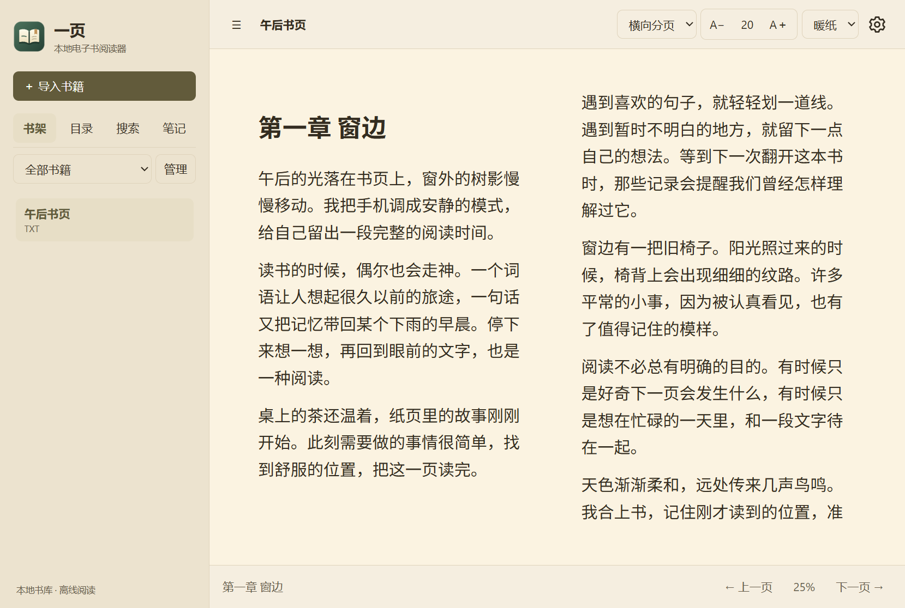
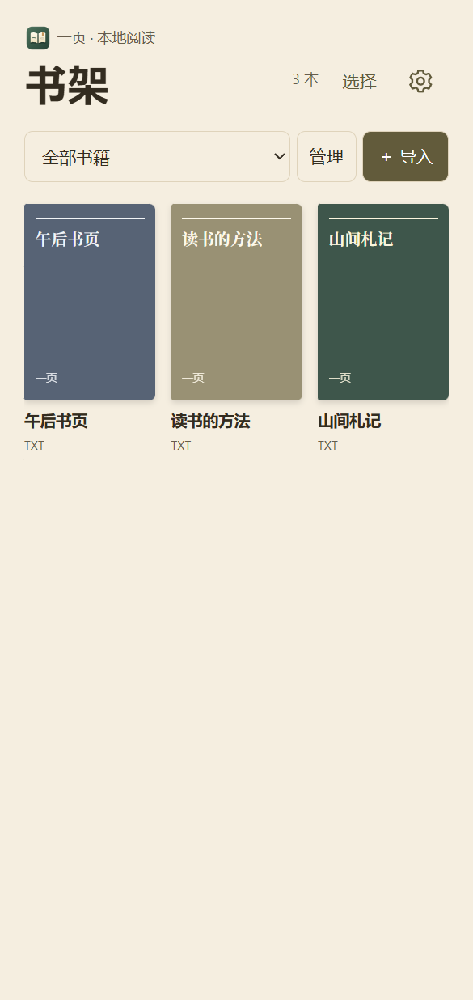
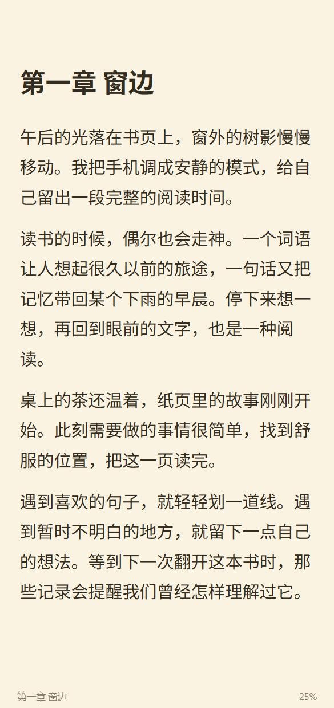

# 一页 · Leaf Reader

一页是一款面向 Windows 和 Android 的本地电子书阅读器。打开书架，导入自己的电子书，专注阅读、划线和记录想法。

这个项目来自日常阅读中的一个需求，希望阅读器把主要空间和操作留给书籍。功能围绕本地书架、阅读排版和笔记展开。

## 下载与安装

| 平台 | 当前版本 | 使用方式 |
| --- | --- | --- |
| Windows x64 | 0.6.2 | 下载 ZIP，完整解压后双击 `LeafReader.exe` |
| Android | 0.2.1 | 下载 APK，在系统中确认安装 |

[下载最新版本](https://github.com/Aesthans/leaf-reader/releases/latest)

Windows 版需要保留整个发行文件夹。升级时先关闭旧窗口，再运行新版，同一 Windows 用户的本地书架和阅读进度会沿用。

Android 支持 Android 10 及以上，阅读内核使用系统 WebView。PDF 需要 Chromium 125 或以上的 WebView，版本过旧时会提示更新。同签名 APK 可以覆盖升级，书籍和笔记保存在本机，卸载前请保留需要的资料。

## 界面



| Android 书架 | Android 阅读 |
| --- | --- |
|  |  |

截图使用项目自编示例文本。

## 功能与使用

- 点击「导入书籍」，或将 EPUB、TXT、MOBI、AZW3、PDF 文件拖进窗口。书架保留导入的本地副本。Kindle 格式支持无 DRM 的书籍。
- 「书架 → 管理」可创建、重命名分区，勾选书籍后批量移动或移除。查看某个分区时，新导入的书会进入该分区。
- 移除书籍会删除应用中的副本、阅读进度及该书笔记，原始文件会保留。删除分区时，该分区中的书籍会回到「未分区」。
- TXT 支持 UTF-8、GB18030（兼容 GBK）及带 BOM 的 UTF-16，并尝试从章标题生成目录。
- 横向分页时，可以点击正文两侧、按左右方向键或使用底部按钮翻页。点击书内链接和选中文字时保留正文原有操作。
- 选择「纵向滚动」后，使用鼠标滚轮或上下方向键阅读。到达章首或章末后，继续滚动可切换章节。
- 点击「目录」可跳到指定章节。顶部可调整字号，或在白纸、暖纸、夜间之间切换。固定版式书籍保留原版面和分页。
- 应用会记住上次打开的书、正文位置和阅读设置。使用 `Ctrl+O` 可打开文件选择器。
- PDF 保留原版面，支持单页翻阅、连续滚动、缩放和输入页码跳转。PDF 自带目录时可从侧栏跳转。续读会恢复页内位置、缩放和模式。扫描件可以直接阅读。需要打开密码的 PDF 会提示导入可直接打开的版本。
- 打开书后，可用侧栏「搜索」或 `Ctrl+F` 查找本书全文。点击结果可跳到对应位置。纯图片 PDF 没有可供搜索、选字的文字层。
- PDF 搜索兼容英文单词在行尾断词的排版，点击结果会定位匹配文字并短暂高亮。
- 在「笔记」里可添加当前位置书签。选中文字后可高亮或写批注。点击笔记条目可返回原位置，批注可编辑，阅读标记随该书保存在本机。
- 新建笔记保存完整选区摘录，手机笔记列表会缩略长摘录，打开「写想法」或「编辑想法」可查看完整原文。升级前已截短的摘录可以重新选择正文并保存以更新。
- 选中文字后可设置五种颜色及高亮、直线、波浪线。在笔记列表点「改样式」可修改已有标记。
- 工具栏的齿轮打开阅读设置，可统一调整主题、字号、行距和电子书阅读方式，并查看累计及本书阅读时长。窗口切到后台、最小化或打开设置时暂停计时。
- 升级时，先关闭旧窗口，再打开新版。同一 Windows 用户的本地书架和进度会沿用，已有书籍初始位于「未分区」。

## Android 操作

安装 APK 后，首页是本地封面书架。顶部可导入文件、切换分区或管理书籍。导入后留在书架，点封面开始阅读。轻点正文中央可显示或收起工具栏。电子书单页模式下点两侧或横向滑动可触发仿真翻页。长按正文选中文字，可在浮动菜单直接划线或写想法。保存后继续在当前页阅读，也可以打开「笔记」按章节查看记录。

长按书籍封面或点书架顶部的「选择」可进入多选。长按分区封面会选中该分区里的书籍。底部可以批量移动分区或移出书架。

书架右上角的设置提供默认主题、字号、行距、电子书翻页方式和笔记位置。书内单独调整的设置随书保存。设置页显示本机累计阅读时长，笔记页显示本书阅读时长。离开阅读页或切到后台时暂停计时。

手机端长按正文选词后，点击「查词」会显示联网查询结果，提供词语释义和拼音。查询可能使用萌典、维基百科、维基词典，网页搜索提供 Bing 和百度。查询时发送所选词语或拆分后的词语。

电脑和手机的书库各自保存在设备上。笔记当前保存在应用本机书库中。

## 从源码运行

安装 Node.js 22 或以上和 npm，进入源码目录执行。

```sh
npm ci
npm start
```

`npm ci` 会安装锁定版本的依赖并下载 Electron 运行时。若 Electron 下载中断，修复网络配置后可执行 `node node_modules/electron/install.js` 重试。

### Windows 打包

在 Windows x64 上执行。

```sh
npm run package
```

产物位于 `release/LeafReader-<版本>-win-x64`。分享应用时，将整个文件夹压缩为 ZIP。

### Android 打包

安装 JDK 17、Android SDK Platform 36 和 Build Tools 36.0.0，配置 `JAVA_HOME` 与 `ANDROID_SDK_ROOT` 后执行。

```sh
npm ci
npm run mobile:package
```

APK 位于 `release`。仅生成手机界面的网页资源时，可运行 `npm run mobile:assets`。

本地构建使用 `.android-build/leaf-test.jks` 签名，该目录已被 Git 排除。首次构建会生成自己的测试签名，后续覆盖安装需要沿用同一个签名。项目发行版使用维护者保管的签名。

## 问题反馈

遇到问题时，请在 Issues 中提供应用版本、系统版本、手机型号或电脑系统，以及具体操作步骤。书籍相关问题请注明格式、大小和文件来源，便于判断导入、排版或文件兼容性问题。

## 许可与致谢

项目自身使用 MIT 许可证。[项目许可证](LICENSE)

电子书内核复用 foliate-js，PDF 使用 PDF.js，Windows 运行时使用 Electron。第三方组件保留各自的版权声明与许可证。[第三方说明](THIRD_PARTY_NOTICES.md)
